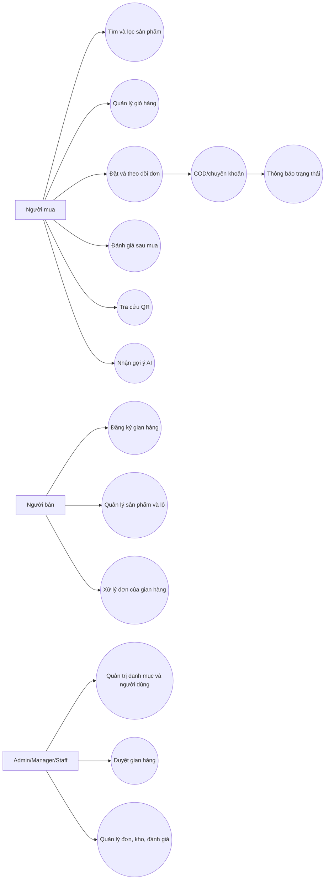
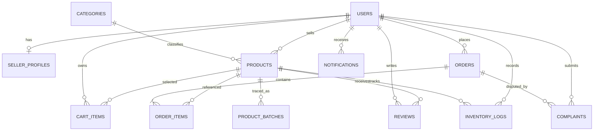

# Phân tích yêu cầu hệ thống AgriSmart

Tài liệu này mô tả phạm vi hiện có trong source hiện tại, không giả định rằng chứng nhận, nguồn gốc hay thanh toán đã được bên thứ ba xác minh nếu hệ thống chưa nhận được bằng chứng đó.

## Mục tiêu

Kết nối người mua nông sản với gian hàng; hỗ trợ đăng bán, giỏ hàng, đặt và theo dõi đơn, truy xuất dữ liệu sản phẩm/lô bằng QR, quản lý vận hành và trợ lý AI. Dữ liệu vận hành được lưu trong MySQL; web Next.js gọi API Express. AI là dịch vụ riêng và có phương án xếp hạng dự phòng khi dịch vụ AI không sẵn sàng.

## Đối tượng sử dụng

| Vai trò | Nhiệm vụ chính |
|---|---|
| Khách chưa đăng nhập | Xem landing, danh mục, sản phẩm, thông tin công khai và trang giới thiệu |
| Người mua (`customer`) | Quản lý hồ sơ, giỏ hàng, đặt/hủy đơn đủ điều kiện, thanh toán, theo dõi, khiếu nại, đánh giá sau đơn hoàn tất, nhận gợi ý |
| Người bán (`seller`) | Đăng ký gian hàng; sau khi được duyệt thì quản lý sản phẩm/lô, đơn thuộc gian hàng, doanh thu, phản hồi đánh giá/khiếu nại và dùng AI hỗ trợ |
| Nhân viên (`staff`) | Xem và xử lý đơn/giao vận theo quyền được cấp |
| Quản lý (`manager`) | Xem dashboard, vận hành đơn, xem hồ sơ gian hàng, quản lý danh mục và dữ liệu vận hành được cấp |
| Quản trị viên (`admin`) | Quản trị hệ thống, tài khoản, danh mục, sản phẩm, kho, đánh giá, gian hàng, đơn hàng và cấu hình |

## Yêu cầu chức năng

1. Tài khoản: đăng ký, đăng nhập/đăng xuất, phân quyền theo vai trò, xem/sửa hồ sơ, đổi mật khẩu và bật xác thực hai bước.
2. Sản phẩm: tạo, cập nhật, ẩn/xóa mềm, xem danh sách/chi tiết, tìm kiếm và lọc theo danh mục; quản lý ảnh, giá, đơn vị, tồn, nơi thu hoạch, vùng trồng, ngày thu hoạch, bảo quản và mã truy xuất.
3. Danh mục: liệt kê công khai; admin/manager tạo và sửa; admin xóa nếu không có sản phẩm phụ thuộc.
4. Giỏ hàng và đơn: thêm/sửa/xóa mặt hàng, tính tạm tính/giảm giá/phí giao hàng/tổng; nhập thông tin nhận hàng, chọn phương thức thanh toán, tạo đơn chống trùng yêu cầu, xem chi tiết/lịch sử và hủy khi trạng thái cho phép.
5. Thanh toán: COD/chuyển khoản ngân hàng, hiển thị phí và tổng trước khi đặt; đối soát chuyển khoản qua webhook khi cấu hình được, hoặc quản trị viên xác nhận thủ công. Trạng thái “khách báo đã chuyển” không đồng nghĩa tiền đã nhận.
6. Kho: xem tồn, ghi nhận nhập/xuất/điều chỉnh, ngưỡng sắp hết và nhật ký thay đổi.
7. Truy xuất: tạo mã QR từ mã sản phẩm/lô; trang công khai trả về sản phẩm, gian hàng, vùng/nơi thu hoạch và thông tin do người bán khai báo; mã không khớp trả lỗi.
8. Thông báo: tạo thông báo đơn/trạng thái/hủy/tồn thấp, xem danh sách, số chưa đọc và đánh dấu đã đọc.
9. Đánh giá: người mua chỉ gửi đánh giá sau khi đơn có sản phẩm đó hoàn tất; lưu điểm và bình luận; người dùng chỉ sửa đánh giá của mình; admin có thể kiểm duyệt/xóa.
10. Gợi ý: dùng sự kiện xem/mua và danh mục ưu tiên; nếu dịch vụ AI vắng mặt thì trả kết quả sắp xếp dự phòng, nêu rõ cách dự phòng.
11. Admin: dashboard thống kê dữ liệu thật, quản lý đơn, duyệt gian hàng, quản lý người dùng/sản phẩm/danh mục/kho/đánh giá theo quyền.

## Yêu cầu phi chức năng

- Phân quyền phải được kiểm tra tại API, không chỉ ẩn nút trên giao diện.
- Mọi truy vấn dữ liệu theo người dùng phải giới hạn bằng user ID lấy từ token; không nhận ID chủ thể từ client để thay quyền.
- Tạo đơn và trừ tồn kho phải nằm trong transaction; yêu cầu lặp lại cùng khóa idempotency không được tạo thêm đơn.
- Kiểm tra/chuẩn hóa đầu vào; không ghép trực tiếp giá trị client vào SQL. Danh sách vai trò/trạng thái phải là allowlist.
- Mật khẩu lưu dạng hash; token, khóa API và bí mật thanh toán phải nằm trong biến môi trường, không commit vào source.
- UI báo lỗi/thành công bằng tiếng Việt, trạng thái rỗng/loading rõ ràng; dùng layout responsive và label accessible.
- Thông tin chứng nhận/nguồn gốc do gian hàng khai báo phải gắn nhãn phù hợp; không mô tả như dữ liệu được kiểm định nếu chưa có quy trình xác minh.

## Use cases

## Quy trình hoạt động chính

### Mua hàng

Người mua chọn sản phẩm đang mở bán từ gian hàng đã duyệt → hệ thống kiểm tra giá/tồn và tính giỏ → người mua nhập địa chỉ, chọn phương thức và thấy phí giao hàng → API tạo đơn trong transaction, giữ tồn và lưu khóa idempotency → đơn hiển thị trong danh sách/lịch sử → người mua theo dõi; được hủy chỉ khi trạng thái còn cho phép → sau khi hoàn tất có thể gửi đánh giá.

### Gian hàng

Người dùng tạo hồ sơ gian hàng → hồ sơ chờ admin/manager duyệt → chỉ hồ sơ được duyệt mới được đăng sản phẩm → người bán khai báo dữ liệu sản phẩm/lô → đơn liên quan được lọc theo sản phẩm thuộc gian hàng.

### QR truy xuất

Tạo mã từ sản phẩm/lô trong dữ liệu → QR trỏ đến API tra cứu công khai → tra cứu mã hợp lệ trả dữ liệu nguồn gốc đã khai báo → mã sai hoặc lô không tồn tại trả 404. QR không tự chứng minh tính xác thực của khai báo.

### Chuyển khoản

Đơn sinh nội dung chuyển khoản duy nhất → khách báo đã chuyển → hệ thống chờ webhook/đối soát; không tự kết luận tiền vào chỉ dựa trên ảnh hay thao tác của khách → callback hợp lệ hoặc admin xác nhận mới cập nhật `paid`.

## ERD khái quát

## Giới hạn tích hợp

- Auto bank reconciliation requires valid webhook/API credentials and a reachable public HTTPS callback endpoint; local-only development cannot receive bank callbacks.
- Tính năng camera scan QR depends on browser camera permission and a QR decoder in the client; the public trace endpoint already supports lookup by code.
- Ảnh sản phẩm, chứng nhận, vùng/nơi thu hoạch are user-submitted unless a verification workflow is recorded.
